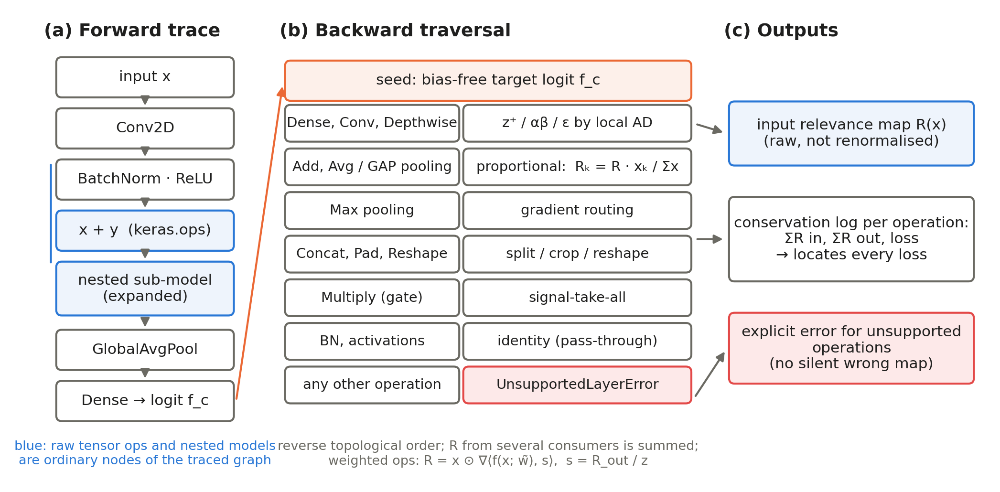

# TFRP — Configuration-free layer-wise relevance propagation over framework computational graphs

This repository contains the implementation of **TensorFlow Relevance Propagation (TFRP)**, the experiment code, and the results of the paper

> *Configuration-free layer-wise relevance propagation over framework computational graphs* (under review).

TFRP is an **execution framework** for existing layer-wise relevance propagation (LRP) rules. It introduces no new rule; it executes the standard rules (z⁺, ε, αβ and composites) over the computational graph that TensorFlow/Keras actually runs, so that a model can be explained **as it is, without model-specific rewriting ("canonization")**.



## Why

LRP toolboxes attach rules to layers or modules. Operations that are written as functions — residual additions `x + y`, multiplicative gates, functional pooling — and batch normalisations that cannot be folded bypass the rules unless the user rewrites the model. The failure is usually silent: the returned map loses or multiplies relevance without a warning.

TFRP

- records the forward pass **node by node in Keras' own execution order**, so raw tensor operations and nested sub-models are part of the traversed graph;
- applies **one generic rule per operation type**, computed locally with automatic differentiation, so no model-specific code is needed;
- seeds the backward pass with the **bias-free target logit** and logs the relevance before and after **every operation** (conservation log);
- **raises an error** for operations without a rule instead of returning a silently wrong map.

## Main results

| | Result |
|---|---|
| Correctness | With identical networks, inputs and rules, TFRP reproduces canonized Zennit exactly: median Pearson r ≥ 0.9999 on VGG16, ResNet50, InceptionV3 and MobileNetV2 for the z⁺, αβ and composite rules (1,000 images). |
| Configuration burden | Module-hook LRP needs 0–63 manually rewritten sites per model on seven ImageNet architectures; dedicated canonizers exist for two of them. TFRP needs none. |
| Out-of-the-box conservation | TFRP conserves relevance on VGG16, ResNet50, InceptionV3 and DenseNet121 (median relative conservation error ≤ 7.0×10⁻³ %). On MobileNetV2, EfficientNet-B0 and ConvNeXt-T, the loss is the relevance absorbed by bias-driven units under the z⁺ rule, which every correct implementation shows; a per-layer audit locates it exactly. |
| Faithfulness (ResNet50, 14 methods) | No method is best on every metric. TFRP z⁺ is among the most faithful methods on Deletion, AOPC and MuFidelity. |
| Cost | 0.26–0.72 s per image on a CPU, of the same order as Zennit, Captum and iNNvestigate. |

## Quick start

TFRP needs only TensorFlow/Keras (environment A below).

```bash
pip install -r requirements/env_A_tf.txt
python example.py path/to/image.jpg
```

[`example.py`](example.py):

```python
import sys
sys.path.insert(0, 'exp_code/tfrp')

import numpy as np
import tensorflow as tf
from general_TFRP_v2 import get_relevance_map_generalized

# a Keras model, used as is (no rewriting, no canonization)
model = tf.keras.applications.ResNet50(weights='imagenet')

# an input image, preprocessed as for the model
img = tf.keras.utils.load_img('image.jpg', target_size=(224, 224))
x = tf.keras.applications.resnet50.preprocess_input(np.array(img, dtype=np.float32)[None])

# relevance of the top-1 class with the z+ rule (default)
R, seed, total, leak = get_relevance_map_generalized(model, x)
print(f'relative conservation error = {abs(total - seed) / abs(seed) * 100:.2e} %')

heat = np.asarray(R)[0].sum(-1)          # relevance map (sum over colour channels)

# optional: the per-operation conservation log (operation, type, relevance in, relevance out)
*_, log = get_relevance_map_generalized(model, x, return_layer_log=True)
```

Output for an ImageNet koala image:

```
explained score (bias-free logit) = 15.4224
sum of input relevance            = 15.4224
relative conservation error       = 6.18e-06 %
  predictions            Dense                       15.4224    15.4224
  avg_pool               GlobalAveragePooling2D      15.4224    15.4224
  conv5_block3_out       Activation                  15.4224    15.4224
```


### Main options of `get_relevance_map_generalized`

| Argument | Default | Meaning |
|---|---|---|
| `target_class_idx` | `None` | class to explain (`None`: top-1 prediction) |
| `global_rule` | `'z_plus'` | `'z_plus'`, `'epsilon'` or `'alpha_beta'` |
| `composite_preset` | `None` | rule per layer type, e.g. `{'Conv2D': 'alpha_beta', 'DepthwiseConv2D': 'alpha_beta', 'Dense': 'epsilon'}` |
| `alpha`, `beta`, `epsilon` | 2, 1, 0.1 | rule parameters |
| `add_rule`, `avgpool_rule` | `'proportional'` | redistribution at additions and average pooling (`'uniform'` / `'gradient'` for a uniform split) |
| `return_layer_log` | `False` | also return the per-operation conservation log |
| `renormalize` | `False` | rescale the map to the explained score (off: the raw relevance is returned) |

Returns `(R, seed, total, leakage_pct[, layer_log])`: the input relevance (same shape as the input), the explained score, the summed input relevance and the signed loss in percent. Module-level switches in `general_TFRP_v2.py`: `ZPLUS_FALLBACK = 'flat' | 'w2'` enables the optional bias-aware variant of z⁺ (off by default).

### Supported operations

| Operation | Rule |
|---|---|
| Dense, Conv2D, DepthwiseConv2D, grouped convolution | z⁺ / ε / αβ via a local AD computation (strides, padding, dilation, groups of the layer itself) |
| Add (layer or tensor `+`), average and global average pooling | proportional (LRP-0 / "Norm") |
| Max and global max pooling | gradient routing to the maximum |
| Concatenate, zero padding, flatten, reshape | slice / crop / inverse reshape |
| Multiply (gate) | all relevance to the signal input |
| Activations, batch / layer normalisation, dropout, rescaling | identity |
| Nested functional / sequential models | expanded in place |
| Anything else (e.g. attention) | `UnsupportedLayerError` |

## Repository structure

```
README.md, example.py
requirements/            pinned packages of the three environments
exp_code/
  tfrp/general_TFRP_v2.py   TFRP
  tfrp/general_TFRP_v1.py   earlier version of the implementation (used only for comparisons in E0, E3, E12, E13)
  common/preprocess.py      shared image cache and model-specific preprocessing
  common/keras_graph_torch.py  identical PyTorch copies of the Keras CNNs (for Zennit / Captum)
  e*.py, run_*.sh            experiments (see below)
exp_result/E*/            results of each experiment (per-image CSVs, summaries, figures)
docs/                     image of the README example
```

## Environments

The compared libraries need different software stacks. Each script states its environment in its first lines.

| | Python | Main packages | Used for |
|---|---|---|---|
| A | 3.12.6 | TensorFlow 2.20, Keras 3.14, Xplique 2.0.1 | TFRP, gradient / CAM / perturbation methods, all metrics, figures |
| B | 3.12.6 | PyTorch 2.14.1 (CPU), torchvision 0.29.1, Zennit 1.0.0, Captum 0.9.0 | Zennit, Captum |
| C | 3.7.4 | TensorFlow 1.15, Keras 2.2.4, iNNvestigate 1.0.9 | iNNvestigate |

The shell scripts use the interpreters given by the environment variables `PY_TF`, `PY_TORCH` and `PY_LEGACY` (default: `python`). iNNvestigate is run with `KERAS2_HOME` (default `~/.keras2_home`) as its home directory, so that Keras 2 keeps a weight cache separate from Keras 3. All experiments were run on a CPU (Intel Core Ultra 5 225, 16 GB RAM).

## Reproducing the experiments

**Data.** The images are the public ImageNet sample collection [imagen](https://github.com/ajschumacher/imagen) (1,000 JPEG images, five for each of the 200 ILSVRC 2017 detection categories). Put the images in `data/imagen/` (or set `TFRP_IMAGE_DIR`).

**Cache.** Decode the images once and export the Keras models for the PyTorch environment (written to `cache/`, or to `TFRP_CACHE`):

```bash
python exp_code/e1_prepare.py            # environment A
```

All scripts are run from the repository root. Explanations target the top-1 predicted class; random subsets are drawn with fixed seeds.

| Exp. | Paper | What | Scripts (environment) | Results |
|---|---|---|---|---|
| E0 | §3.6 | unit tests of every operation type; network-level check | `e0_unit_tests.py`, `e0_cnn_check.py` (A) | `E0/` |
| E1 | §5.1, Table 4, Fig. 2 | five implementations on identical networks, four rules, 1,000 images | `run_e1.sh` → `e1_tfrp.py` (A), `e1_torch.py` (B), `e1_innvestigate.py` (C); `e1_analyze.py` (A) | `E1/` |
| E13 | §5.2, Table 6 | out-of-the-box conservation, seven architectures, each library on its own model zoo | `run_e13.sh` → `e13_tfrp_keras.py` (A), `e13_torch_zennit_captum.py` (B), `e13_innvestigate_keras2.py` (C); `e13_analyze.py` | `E13/` |
| E14 | §5.2, Table 5 | sites that require canonization (torch.fx) vs. TFRP | `e14_torch_sites.py` (B), `e14_keras_sites.py` (A) | `E14/` |
| E2 | §5.3, Table 7 | layer-wise audit and bias absorption | `e2_layer_profile.py` (A) | `E2/` |
| E8 | §5.3 | bias-aware variant of z⁺ (MobileNetV2, EfficientNet-B0, ResNet50) | `e8_bias_fallback.py` (A) | `E8/` |
| E3 | §5.4, Table 8 | ablation of the TFRP components | `run_e3.sh` → `e3_ablation.py` (A; uses the Zennit maps saved by E1) | `E3/` |
| E9 | §5.5, Table 9 | ε sweep, TFRP vs. canonized Zennit | `e9_epsilon_tfrp.py` (A), `e9_epsilon_zennit.py` (B), `e9_analyze.py` | `E9/` |
| E4 | §5.6, Table 10 | maps of 14 methods and faithfulness / robustness / complexity metrics (ResNet50, 500 images) | `run_e4_maps_tf.sh`, `e4_maps_torch.py` (B), `e4_maps_innvestigate.py` (C), `run_e4_metrics.sh` (A) | `E4/` |
| E5 | §5.6 | statistics: bootstrap CIs, Friedman, Wilcoxon–Holm | `e5_statistics.py` (A) | `E5/` |
| E7 | §5.7, Table 11, Fig. 3 | cascading model-parameter randomisation | `e7_sanity.py` (A) | `E7/` |
| E10 | §5.8, Table 12 | time and memory of the four implementations | `e10_driver.py` (A; starts workers in A, B, C) | `E10/` |
| E15 | §6.1 | node-level path-integrated rule (exploratory) | `e15_generic_rule.py` (A) | `E15/` |
| E12 | Figs. 1–4 | figures | `e12_figures_revision.py`, `e12_figures.py`, `e12_compare_tfrp_zennit.py` (A) | `E12/` |

Several scripts process images in chunks and restart the Python process (`run_*.sh`), because TensorFlow's memory grows over long eager runs; all of them resume where they stopped. The relevance maps of E4 are stored in the cache, not in this repository; the CSV files contain every per-image value used in the paper.

## Result files

| Folder | Main files |
|---|---|
| `E0` | `unit_tests.csv`, `unit_tests_uniform.csv` (per operation type: forward error, conservation, support), `cnn_check_*.csv` |
| `E1` | `tfrp.csv`, `torch.csv`, `innvestigate.csv` (per image × rule); `summary_rce.csv`, `table_rce.md`, `wilcoxon.csv`, `map_agreement.csv` |
| `E2` | `layer_profile.csv` (per image × operation), `leak_decomposition.csv` (per image: leakage, bias absorption) |
| `E3` | `ablation_per_image.csv`, `ablation_fidelity.csv`, `summary.csv` |
| `E4` | `metrics_per_image*.csv` (per method × image), `maps_time_*.csv` |
| `E5` | `summary_metrics.csv`, `table_metrics.md`, `friedman.csv`, `wilcoxon_vs_tfrp.csv` |
| `E7` | `sanity_per_image.csv` |
| `E8` | `per_image.csv`, `summary.csv`, `loss_by_type.csv` |
| `E9` | `tfrp.csv`, `zennit.csv`, `summary.csv`, `summary.md` |
| `E10` | `efficiency.csv` |
| `E12` | figures of the paper (`fig_overview`, `fig_validation`, `fig_randomisation`, `fig_methods`) and `compare_tfrp_zennit_<model>.png` |
| `E13` | `*_per_image*.csv`, `summary_wide.csv`, `summary_long.csv`, `images.txt` |
| `E14` | `torch_sites.csv`, `keras_sites.csv` |
| `E15` | `generic_rule_per_image*.csv`, `generic_rule_summary*.csv` |

RCE is the relative conservation error |Σ R − f| / |f| × 100 %, where f is the explained score of each implementation.

## Citation

The citation will be added after the review.
